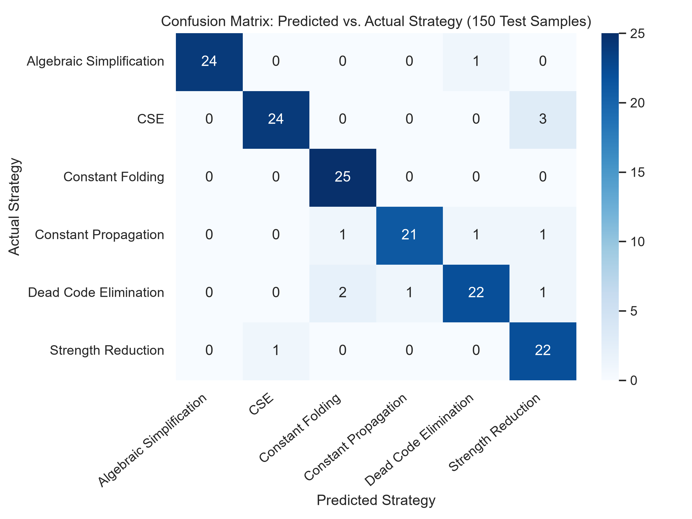
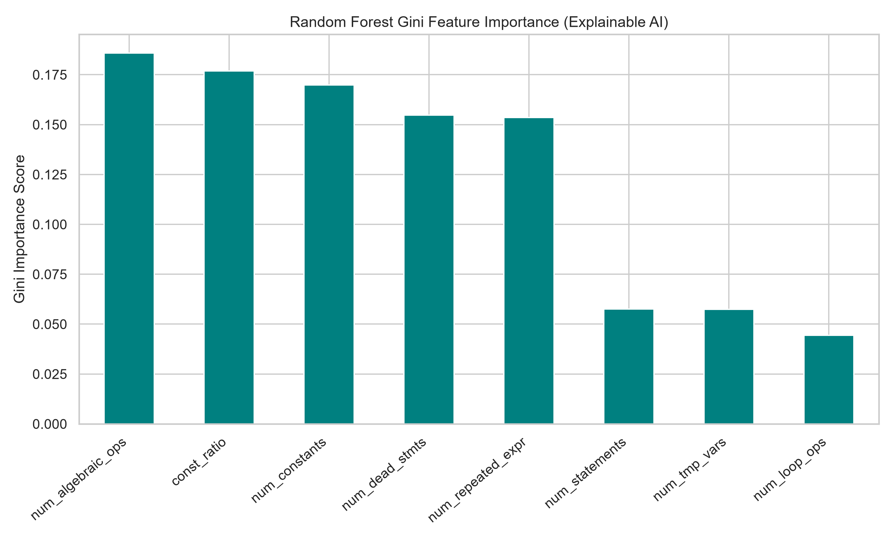

# ML-Guided Compiler Optimization Strategy Selector

A Mini-C to Three Address Code (TAC) compiler pipeline that replaces fixed pass orderings (`-O2`) with a lightweight Random Forest strategy selector, Smart Fallback orchestrator, and semantic equivalence verifier.

**Live Demo:** [Open Streamlit App](https://<your-subdomain>.streamlit.app)

## Architecture & Pipeline
1. **Frontend (`compiler_frontend.py`):** Regex lexer and precedence-climbing recursive-descent parser lowering Mini-C (`while`, `if-else`, arithmetic/relational ops) to TAC.
2. **8D Feature Extractor (`feature_extractor.py`):** Extracts structural IR metrics (`const_ratio`, `num_dead_stmts`, `num_repeated_expr`, `num_algebraic_ops`, etc.).
3. **Smart Fallback Orchestrator (`iterative_loop.py`):** Ranks all 6 passes (`CF`, `CP`, `AS`, `SR`, `CSE`, `DCE`), skips no-op passes dynamically, and iterates to a fixed point.
4. **Semantic Verifier (`optimizers.py`):** Executes original and optimized TAC across 5 input vectors to guarantee 100% output equivalence.

## Evaluation Plots



## Quickstart
```bash
pip install -r requirements.txt
python dataset_generator.py
python ml_pipeline.py
streamlit run app.py